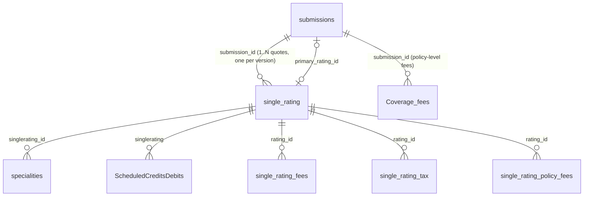

# Rating data structure

How a saved quote is stored: the rating structure, a `single_rating` row per quote with its child tables. The schema is
`db/migrations/001_schema.sql`; reads and writes are in `store.ts`. The pricing itself is in [FORMULA.md](FORMULA.md).

Every child table cascades on delete. Rating-structure column names are lower-cased (Postgres folds unquoted names, so
`ScheduledCreditsDebits` is the table `scheduledcreditsdebits`). Columns added for this app are snake_case.

## Tables

| Table                           | One row per                           | Main columns                                                                                                                                                                                                                                                                                                                                                                                                                                                                                                                                                  | Added here                                                                                                                                                                                                                                                                                                 |
| ------------------------------- | ------------------------------------- | ------------------------------------------------------------------------------------------------------------------------------------------------------------------------------------------------------------------------------------------------------------------------------------------------------------------------------------------------------------------------------------------------------------------------------------------------------------------------------------------------------------------------------------------------------------- | ---------------------------------------------------------------------------------------------------------------------------------------------------------------------------------------------------------------------------------------------------------------------------------------------------------- |
| `single_rating`                 | saved quote version                   | `title` (the label), `location` (state), `county`, `zipcode`, `defense`, `hourseperweek`, `effective_date`, `expired_date`, `retrodate`, `retroyear`, `pickhighest`, `baseratevalue`, `specialityfactor`, `territoryfactor`, `setupfactor`, `setupfactorlable`, `parttime_fulltime_factor`, `basemodifiertotal`, `scheduledpremium`, `totalschedulecreditdebit(amount)`, `credittotal_percentage`, `underwritercreditdebitamount`, `creditdebitpercentagetotal`, `credittotal`, `premium`, `deductible`, `deductiblelable`, `feestotal`, `tax_total`, `total` | `version`, `status`, `rate_group`, `context_version`, `city`, `county_source`, `retro_years`, `territory`, `territory_matched`, tax rates, hours-worked key/title, limit key/limits/`limits_factor`, `policy_fees_total`, `rating_fees_total`, `combine_total`, `inputs`, `flags`, `missing`, `created_by` |
| `specialities`                  | speciality on the quote               | `code`, `title`, `surgery_type`, `location` (class state or `All`), `factor` (`round4(practice% / 100 × class)`), `class`, `selectedclass`, `practice_percentage`, `isdelete`                                                                                                                                                                                                                                                                                                                                                                                 | `sort_order`, `requested` (as the submission named it), `matched_from`                                                                                                                                                                                                                                     |
| `ScheduledCreditsDebits`        | selected credit/debit                 | `title`, `type`, `credit` (%), `amount`, `deductiblelable`                                                                                                                                                                                                                                                                                                                                                                                                                                                                                                    | `sort_order`, `key`                                                                                                                                                                                                                                                                                        |
| `single_rating_fees`            | rating fee                            | `lable`, `value` (fee amount), `state`, `percentageofcalculatedpremium` (calculated fees), `percentageofearn`                                                                                                                                                                                                                                                                                                                                                                                                                                                 | `sort_order`, `key`, `calculate`, `required`                                                                                                                                                                                                                                                               |
| `single_rating_tax`             | tax (domicile state, then risk state) | `lable` (`"<state> <rate>% Tax"`), `value`                                                                                                                                                                                                                                                                                                                                                                                                                                                                                                                    | `sort_order`, `rate`                                                                                                                                                                                                                                                                                       |
| `single_rating_policy_fees`     | policy fee the rating was priced with | `title`, `amount`, `percentageofearn`                                                                                                                                                                                                                                                                                                                                                                                                                                                                                                                         | all                                                                                                                                                                                                                                                                                                        |
| `Coverage_fees`                 | policy fee of the submission          | `title`, `amount`, `percentageofearn`                                                                                                                                                                                                                                                                                                                                                                                                                                                                                                                         | `key`                                                                                                                                                                                                                                                                                                      |
| `submissions.primary_rating_id` | —                                     | the submission's primary rating                                                                                                                                                                                                                                                                                                                                                                                                                                                                                                                               |                                                                                                                                                                                                                                                                                                            |

## Rules

- **Versions.** Each save is a new `single_rating` row (`version` 1, 2, …). The one exception is an underwriter's
  "Save changes to vN" (`PUT /api/submissions/:id/quotes/:quoteId`): the row is re-priced in place, keeping its id,
  version and creator, its child rows replaced, and a `QUOTE_UPDATED` audit row records the totals it had. Nothing
  else changes a saved row; only `primary_rating_id` and `Coverage_fees` move.
- **INCOMPLETE quotes.** A rating that cannot be priced is saved with `status = 'INCOMPLETE'`, the factors it could
  resolve, and the `missing` list. The premium and totals stay NULL, and so does the `value` of a calculated fee or
  the `amount` of a credit (never 0).
- **Limits factor.** Our formula multiplies in the ILF/DLF limits factor, so `basemodifiertotal` =
  speciality × step-up × territory × limits × FTE (`limits_factor`).
- **Coverage fees** come from the required policy fees of the rate group. Each new quote replaces the submission's
  set, and each quote keeps its own fees in `single_rating_policy_fees` (`policy_fees_stored = true`), which is what
  that version shows. Ratings saved before fees were kept per rating (`policy_fees_stored = false`) show the submission's
  `Coverage_fees`, the only fees stored for them.
- **Money** columns are `numeric(14,2)` (`scheduledpremium` `numeric(14,4)`); rates, factors and percentages stay
  `double precision`, copied unchanged from the rate tables. pg returns numeric as a string: `loadQuotes` converts.
- **Primary rating.** The first priced quote becomes primary (an INCOMPLETE one is primary only while there is nothing
  else). After that it changes only through `PUT /api/submissions/:id/primary-rating`. The Underwriting Analysis and
  chat read the primary rating.
- **Deductibles.** A deductible-type scheduled credit is its row in `ScheduledCreditsDebits`, and its amount and label
  are also on `single_rating.deductible` / `deductiblelable`. There is no separate `SingleRatingDeductible` table.
- **IDs** are UUIDs for `single_rating` (like every other table in this app) and bigserial for the child rows.

The API still returns each quote as `{ inputs, factors, pricing, … }` (`loadQuotes` in `store.ts` rebuilds it from the
rows), plus `isPrimary`.
